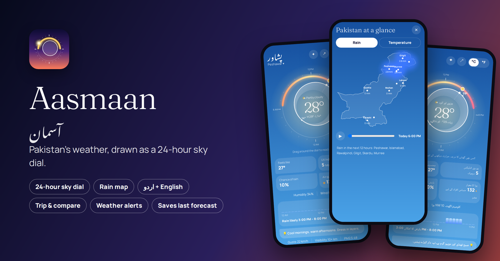
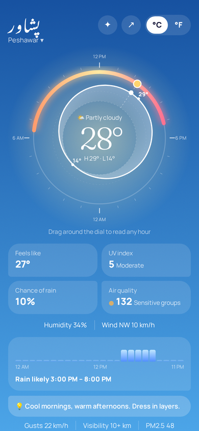
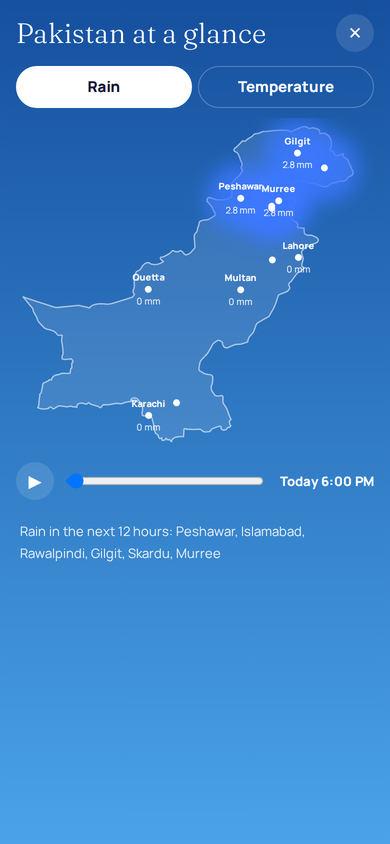
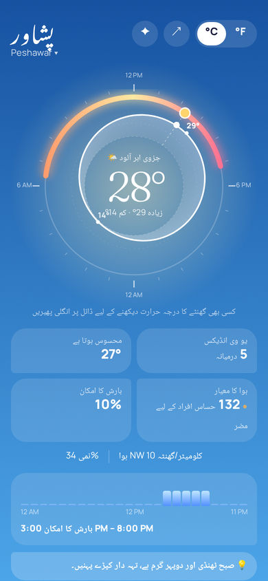
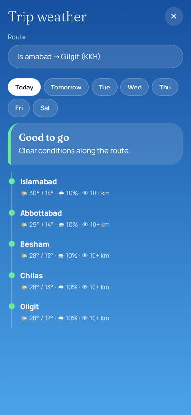

# Aasmaan (آسمان) – Pakistan weather, drawn as a sky

A weather app for Pakistan where the whole day is one **24-hour sky dial**: the daylight arc, the temperature curve and the sun's position, all in a single circle you can drag to read any hour.



| Sky dial | Rain map | Urdu mode | Trip weather |
|---|---|---|---|
|  |  |  |  |

*Screenshots use sample forecast data.*

## Features
- **Forecast:** current temperature, feels-like, humidity, wind (with direction and gusts), UV, air quality (AQI, PM2.5, dust), visibility, 7-day high/low.
- **°C / °F switch** and **12 Pakistani cities** (with Urdu names), plus search for any town in Pakistan and a "use my location" button.
- **Sunrise and sunset for every day**, live countdown, golden hour, how much daylight is gained or lost per day, and moon phase. Calculated offline too (NOAA algorithm) so they work without a connection.
- **Sky that follows the real time:** night, dawn, day and dusk themes, stars at night, rain streaks on rainy days.
- **Rain & temperature map** of Pakistan with a 48-hour slider.
- **Compare cities**, **Trip weather** (8 road routes: rain, fog and heat at each stop) and **Plan my day** (best day and time for a walk, hike, cricket, picnic and more, from simple rules over the hourly forecast).
- **Alerts:** heat, freezing nights, rain, heavy rain / flood risk, dense fog, strong wind, dust, UV, unhealthy air.
- **English and Urdu** interface.
- **Installable (PWA)** and **offline-ready:** the last forecast is saved and clearly labelled as saved when you have no internet.

## Run it
```bash
cd web
python3 -m http.server 8000      # then open http://localhost:8000
```
Location, the service worker and "Install" need `localhost` or HTTPS. To use it on a phone, host the `web/` folder on any HTTPS static host (Netlify, GitHub Pages) and choose *Add to Home Screen*.

## Android APK
No Gradle or Android Studio needed. On Ubuntu/Debian:
```bash
sudo apt install openjdk-17-jdk-headless aapt apksigner zipalign dalvik-exchange android-sdk-platform-23 libandroid-23-java
bash android/build.sh            # -> android/build/aasmaan.apk
```
The APK is a thin native WebView wrapper around the same web app (fonts bundled, native share and notifications, location permission, back button). It is signed with a debug-style key for side-loading. Publishing on Google Play needs an AAB, your own release key and a current target SDK.

## How it works
- **Data:** [Open-Meteo](https://open-meteo.com) forecast, air-quality, geocoding and archive APIs (no API key).
- **Stack:** plain HTML/CSS/JavaScript and SVG, no frameworks. The dial is drawn with polar coordinates (midnight at the bottom, noon at the top).
- **Offline:** each forecast is stored in `localStorage` with a timestamp; if a request fails the app shows the saved copy and says so.
- **Map outline:** Natural Earth data (via `world-atlas`), simplified into one SVG path.

## Testing
`python3 tests/test_app.py` runs 65 automated checks in a headless browser: unit conversion, every city, search/add/remove, location, all alert thresholds (including fog that has already passed today), the map, compare, all 8 trip routes and their verdicts, all 7 plan activities and question parsing, offline/online, Urdu coverage, layout at 320/360/412 px, and sunrise/sunset accuracy against the independent `astral` library (worst error ≈ 1.4 min).

**What is not covered:** the tests use *simulated* Open-Meteo responses, so they do not exercise the live service, and the Android build was not run on a physical device or emulator. Please check both on your own phone. Alerts only fire while the app is open (no background alerts yet). The Urdu text should be reviewed by a native speaker; corrections are welcome.

## Limits
Covers Pakistan only. Forecast accuracy is that of Open-Meteo's models, not something this project improves. Open-Meteo's free tier is for non-commercial use. The Plan-my-day thresholds are simple rules of thumb, not tested science.

## Credits
- Weather data by [Open-Meteo.com](https://open-meteo.com/) ([CC BY 4.0](https://creativecommons.org/licenses/by/4.0/)).
- Map outline: [Natural Earth](https://www.naturalearthdata.com/) (public domain).
- Fonts (SIL Open Font License): Fraunces, Manrope, Noto Nastaliq Urdu, Noto Naskh Arabic.
- Built with the help of Claude (Anthropic) as a coding assistant.

## License
MIT, see [LICENSE](LICENSE).
